 

 

 

 

 

  <a href="https://github.com/AbhishekAdvaniExpound">GitHub activity</a>
  &nbsp;·&nbsp;
  <a href="https://github.com/AbhishekAdvaniExpound/AbhishekAdvaniExpound">Profile source</a>

  

<!--
  All visual assets are generated locally by scripts/render_profile.py.
  Contribution statistics come from GitHub's public contribution calendar.
  STATIC=1 python3 scripts/render_profile.py renders motion-free test frames.
-->
